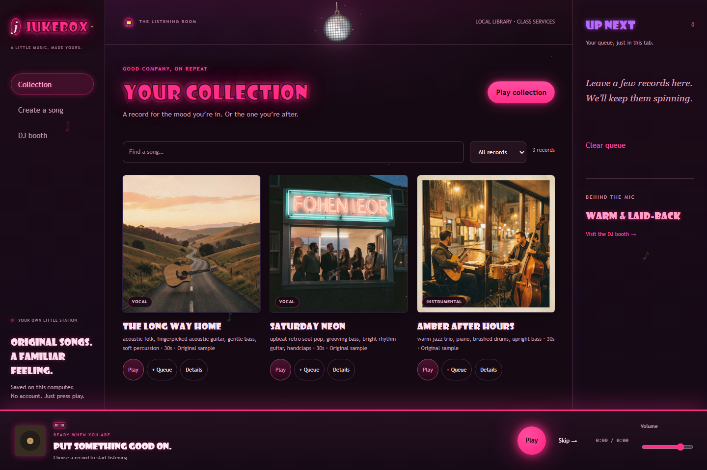
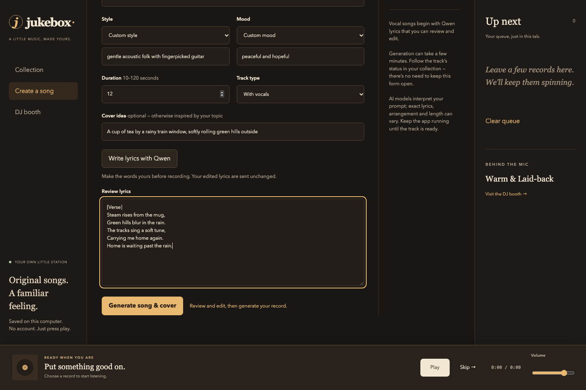
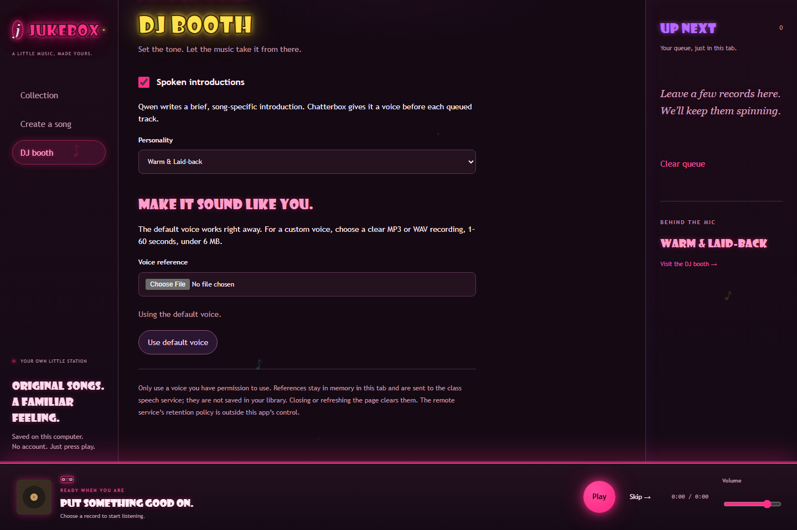

# Jukebox

A little music, made yours. A local Python music app that turns a topic into an original song and matching cover, then plays your collection with a song-specific AI DJ.



> 💿 **The look:** a 70s disco room — glowing neon bubble-letter signs, a spinning mirror ball in the header, midnight-purple walls, hot pink / cyan / yellow neon. All pure CSS: nothing is downloaded, no remote fonts.

## ▶ Quick open

**App already running?** Click here: **[Open the Jukebox](http://127.0.0.1:8765)**

Not running yet? Start it first with the steps below ([Start here](#start-here)), then come back to this link.

## Start here

- **Python 3.12 or newer**, with pip and venv. No Node build, database server, FFmpeg install, or paid account is needed to use the app. A recent Chrome, Edge, Firefox or Safari browser is recommended; the exercised browser is Chrome on macOS.
- Get the instructor-provided `class-endpoints.txt`. Keep it **outside this repository** and outside any submission ZIP. The app reads its `Base URL`, `API Key`, and `Model` labels on the server.
- Internet access to the class services is required for new songs, covers and DJ commentary. The bundled songs and covers play locally without it (turn DJ off).
- Download/extract the project ZIP or clone the repository. Open a terminal **in the extracted Jukebox directory**, the one containing `requirements.txt`.

### macOS / Linux terminal

```bash
python3.12 -m venv .venv
source .venv/bin/activate
python -m pip install --upgrade pip
python -m pip install -r requirements.txt
export JUKEBOX_ENDPOINTS_FILE="$HOME/Downloads/class-endpoints.txt"
python -m jukebox
```

If your installed Python command is `python3`, check `python3 --version` is 3.12+ and use that instead of `python3.12`. If you use `uv`, `uv venv .venv --python 3.12 --seed` is an alternative to the first command; the remaining commands are unchanged.

### Windows PowerShell

Install Python 3.12+ from python.org (include the Python launcher), then:

```powershell
py -3.12 -m venv .venv
.\.venv\Scripts\python.exe -m pip install --upgrade pip
.\.venv\Scripts\python.exe -m pip install -r requirements.txt
$env:JUKEBOX_ENDPOINTS_FILE = "$HOME\Downloads\class-endpoints.txt"
.\.venv\Scripts\python.exe -m jukebox
```

Using the venv interpreter directly avoids PowerShell activation-policy issues. Replace `3.12` with your installed newer version if necessary. **Windows instructions are provided but not yet independently tested on Windows**; see the verification checklist below.

Open **http://127.0.0.1:8765**. Keep the terminal running. Stop with Ctrl+C. For later launches, activate the venv (or use its interpreter), set the external file path, and run `python -m jukebox` again.

The first launch copies the three bundled originals into the local library. Later launches do not duplicate them. Library metadata and generated files live under ignored `data/` and survive restarts. A fresh installation gets its own library. Optional environment variables:

| Variable | Default | Use |
|---|---|---|
| `JUKEBOX_ENDPOINTS_FILE` | unset | Required external endpoint file path for generation/DJ |
| `JUKEBOX_PORT` | `8765` | Pick another unused local port if needed |
| `JUKEBOX_DATA_DIR` | this installation’s `data/` | Optional separate local library directory |

Never set endpoint keys in browser code. [The configuration example](endpoint-config.example.txt) contains placeholders only; it is not a usable credential file. The app deliberately accepts only the required class host and ports, ignoring unrelated endpoints, including port 9000.

## Make a record

1. Open **Create a song**. Enter a topic and optionally a title (otherwise your topic supplies the title).
2. Choose a style and mood, or select **Custom** and describe each. Choose **10–120 seconds**. The service documentation advertises 10–600 seconds and the live model metadata advertises a 300-second maximum; this MVP intentionally caps requests at 120 seconds to keep shared-server jobs modest. Tested lengths are 10, 12 and 30 seconds; not every duration has been tested.
3. **Instrumental** skips lyrics. For **With vocals**, click **Write lyrics with Qwen**, then review/edit the text. Only your explicit **Generate song & cover** starts the audio job. Edited lyrics are sent to ACE-Step unchanged with rewriting disabled; that does not guarantee a model will sing every word exactly.
4. Optionally describe a cover idea; otherwise FLUX uses the song’s topic, style and mood. Click **Generate song & cover**.
5. Your collection shows real named states: waiting, creating music, then painting the cover. Keep the Python app running. No pretend percentage is shown.

New audio becomes playable as soon as it is safely downloaded. If its cover fails, a neutral record placeholder remains and **Retry cover** requests only the art, never another song. Failed audio has **Retry song**. Restart-interrupted jobs are marked retryable; remote work is not resumed automatically.



## Listen and queue

- **Play** on a record starts it now. **+ Queue** appends it. **Play collection** replaces the queue with playable records.
- **Play/Pause** preserves playback intent, even while DJ speech is loading. **Skip** during a DJ intro (or while it loads) starts that intro’s associated song. During music, Skip advances to the next queued record.
- At the end of a song, the next record starts automatically, preceded by its own intro when DJ is on. One audio element serializes speech and music, so they cannot overlap.
- Queue state is in **sessionStorage**, local to the browser tab; independent tabs do not share their controls. Refresh restores queued tracks but never autoplays or restores a voice reference. A duplicated tab may initially inherit its parent’s sessionStorage according to browser behavior, but subsequent changes are independent.
- Browser autoplay policies sometimes require another **Play** click after an asynchronous response. The player shows an actionable notice and keeps a resumable paused state, rather than claiming audio is playing.
- **Details** displays the saved lyrics/concept and lets you download audio. Search and type filtering help navigate the library.

## Visit the DJ booth

Turn spoken introductions on/off. Pick **Warm & Laid-back**, **Upbeat & Playful**, or **Music Enthusiast**. Qwen writes a short introduction using the next song’s actual title, style, mood and topic; Chatterbox speaks it with the default voice without any upload.

For a custom voice, choose an **MP3 or WAV**, **1–60 seconds**, **under 6 MB**. Only use a recording you have permission to use. The file stays in browser/server memory for the request and is sent to the class speech service; this app does not write it to the library or a permanent upload folder. Click **Use default voice** to clear it, or refresh/close the page. The remote service’s retention policy is not controlled by this app. DJ errors show a notice and continue with music.



## What is included

| Original sample | Type / sound | Bundled assets |
|---|---|---|
| Amber After Hours | Instrumental, relaxed jazz trio | [Audio](samples/amber-after-hours/audio.mp3), [cover](samples/amber-after-hours/cover.png), [provenance](samples/amber-after-hours/metadata.json) |
| Saturday Neon | Vocal, upbeat retro soul-pop | [Audio](samples/saturday-neon/audio.mp3), [cover](samples/saturday-neon/cover.png), [Qwen lyrics and provenance](samples/saturday-neon/metadata.json) |
| The Long Way Home | Vocal, reflective acoustic folk | [Audio](samples/the-long-way-home/audio.mp3), [cover](samples/the-long-way-home/cover.png), [Qwen lyrics and provenance](samples/the-long-way-home/metadata.json) |

All three are actual class-service outputs, not third-party samples or synthesized test fixtures. Each fully decodes to **30.0 seconds, stereo, 48 kHz**. Each cover is a new **768×768 PNG**. The vocal lyrics came from Qwen and were passed unchanged to ACE-Step. Prompts, exact lyrics, model names, local UTC generation start time, server-reported creation time and seeds (when returned) are in each metadata file. `generated_at` is the client generation start; `provenance.created_at` is the server-reported audio time, not a independently synchronized clock.

`scripts/generate_samples.py` documents the exact concepts and generation sequence. It resumes without regenerating files that already exist; do not run it just to play the app. Source contracts: [ACE-Step API](https://github.com/ace-step/ACE-Step-1.5/blob/main/docs/en/API.md), class image `/openapi.json`, and class speech `/openapi.json` plus authenticated `/info`. The music model is discovered from live `/v1/models`; speech uses the schema’s `chatterbox-v3` model ID rather than the human-readable endpoint-file label.

## Tests, evidence and design judgment

See **[the test report](docs/testing.md)** for inputs, expected versus actual results, screenshots, the fixed browser integration failure, design tradeoffs and unchecked claims. Machine-readable results are under [docs/evidence](docs/evidence/).

Developer checks (Node is optional and needed only for JavaScript tests):

```bash
python -m pip install -r requirements-dev.txt
python -m pytest -q
node --test tests/*.test.mjs
```

The Python suite uses **offline HTTP/audio fixtures** to test contracts, persistence, safe failures and security. The JavaScript suite uses an explicit fake audio element to test race conditions. These tests are **not** evidence that live model calls worked; the separately labeled real-service and browser reports are. The CI workflow runs offline checks on Linux/macOS/Windows; consult the repository's Actions tab for the outcome on a particular commit. Passing offline Windows checks does not establish a full live-service installation test on Windows.

Important design choice: **persist audio before generating art**, and retry art independently. The test `test_cover_retry_recovers_without_generating_audio_again` proves the saved bytes remain unchanged and the music service is called only once when the cover fails and recovers. This avoids losing expensive successful music to an image-service outage.

## Troubleshooting and limits

- **Configuration needed / HTTP 401 or 403:** check the external endpoint file and its permissions, then restart. Raw upstream errors, URLs containing secrets, and authorization headers are not logged or sent to the browser.
- **Busy / network / timeout:** class services are shared. Retry later. Music polling stops after 20 minutes; a remote job may still finish after local cancellation/restart. The local app cannot cancel remote work.
- **No audio:** click Play, check volume, or Skip a failed track. Imported sample filenames are never used as arbitrary URLs; the player resolves known track IDs through the local API.
- **Image artifacts / awkward lyrics:** generative outputs are imperfect. The diner cover contains invented sign lettering despite the no-lettering prompt, and automated sample lyrics include awkward wording. These are investigated output-quality limitations, not hand-authored replacements. Team listening/quality review remains necessary.
- **Security boundary:** this is a single-process localhost app, not an Internet service or multi-user authentication system. Bind only to loopback. API mutations require same-origin checks and a custom header, uploads/downloads are bounded, only known media is served, and returned music URLs must match the class music endpoint with redirects disabled. The supplied class endpoints use **unencrypted HTTP**; use a trusted network and treat this as a class deployment, not production secret transport.
- **Storage:** `data/` is persistent but is not a backup. Do not place voice references there. Keep your external credential file out of copied folders and ZIPs. Generated custom tracks are intentionally excluded from the submission; only `samples/` is bundled.

## Before the team submits

The [original assignment extraction](docs/original-assignment.md) and [approved addendum](docs/product-addendum.md) are retained. **Security-redaction exception:** limited text is explicitly redacted from the saved extraction. The original PDF is outside this repository. The team must review the redactions against the original before submission without copying sensitive values into public files.

These obligations are **not completed by this implementation**:

- All **five teammates** make a meaningful contribution and review another teammate’s work, using issues and PRs for substantial work.
- Teammates verify the documentation and explain findings in their own words.
- A teammate independently installs/runs from the extracted **GitHub-downloaded ZIP**, using only the documentation and class credentials, and tests all three core features.
- Test on Windows (and other intended browsers); a configured CI matrix is not proof of a run.
- Submit one accessible repository URL, the actual final commit ID, and the GitHub ZIP for **that same commit**, excluding credentials, runtime data, voice files and uploads.

The MVP is intended for teammate review through a pull request before merging. No license was selected on the team’s behalf.
